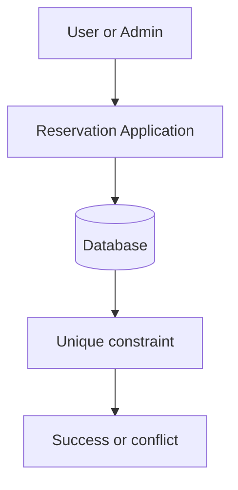
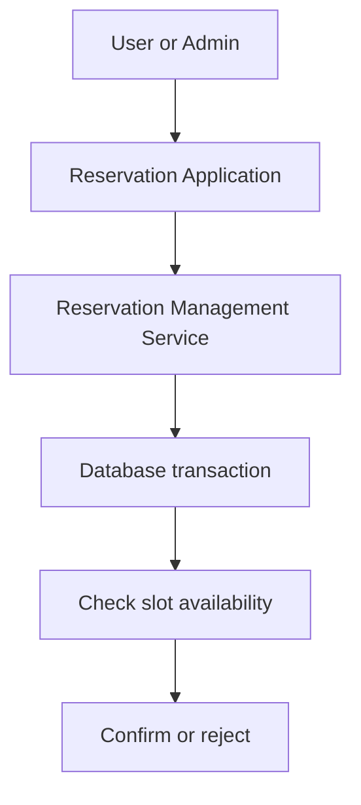
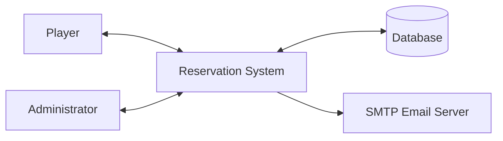
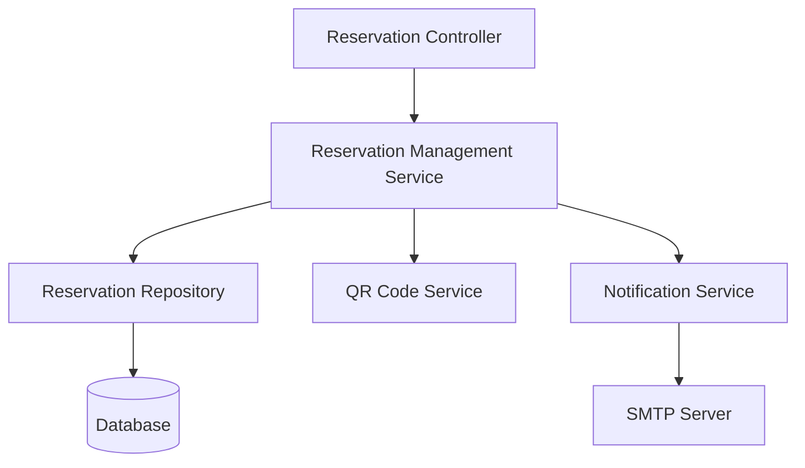
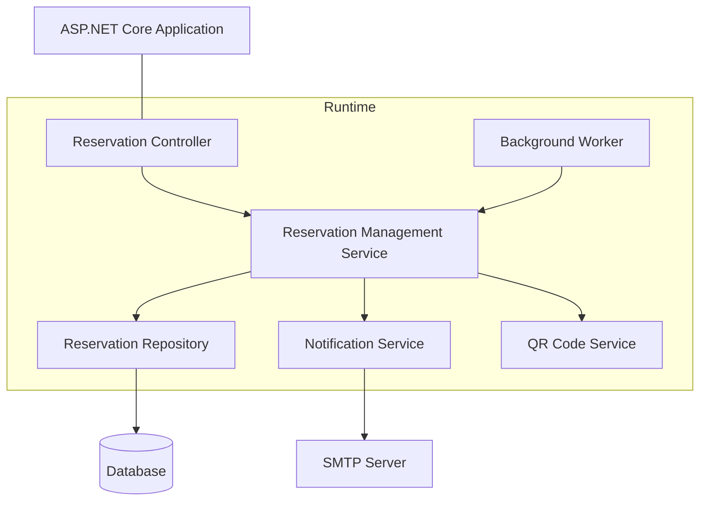
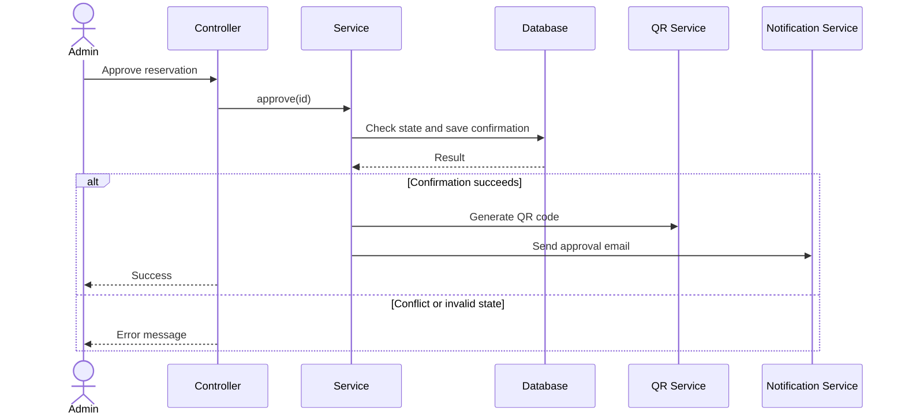
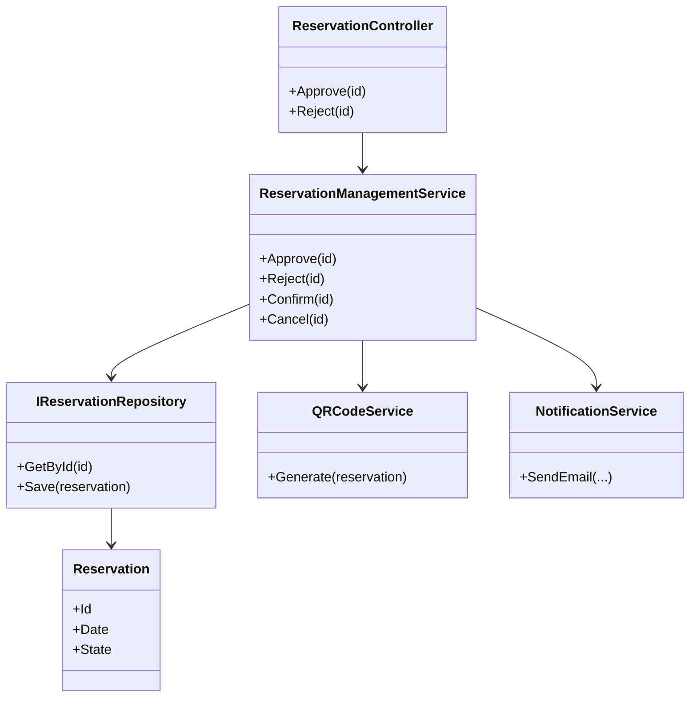

# C01
## Selected future pressure
- Category: C  
- Concrete pressure: Adding support for partial/open reservations (new status: WaitingForPlayers) allowing other users to join an existing reservation, alongside an add-on service for equipment rental.  
- Why it is relevant to our reservation system: Requires extending the core domain logic, state machine, and pricing calculations.

# C03/A — AS-IS Trace

## A1. Scenario reference

- The selected scenario traces how an administrator approves a reservation that is currently in the PENDING_APPROVAL state. The expected result is a transition to CONFIRMED, generation of an access QR code, and an approval email to the user.

| Item | Value |
| -------- | ------- |
| Scenario / operation | OP-05 — Approve / Reject Reservation |
| Requirements | REQ-06, REQ-06b |
| Rules / invariants | BR-02 — Exclusive Resource invariant |
| Baseline | v0.2 |
| Main implementation entry point | ReservationController.Approve(int reservationId)

## A2. Main success path mapped to code

- Scenario: An administrator approves a reservation in the PENDING_APPROVAL state.

| Scenario step | Implementation location | Evidence
| -------- | ------- | ------- |
| 1. The administrator opens the list of pending requests. | `ReservationController.PendingApprovals()` loads reservations in PendingApproval state and returns the view. | ReservationController.cs, lines 316–330. |
| 2. The administrator submits the approval form. | `PendingApprovals.cshtml` contains a POST form targeting the Approve action and sends the reservation ID. | PendingApprovals.cshtml, lines 57–62. | 
| 3. The system checks administrator authorization. | The `[Authorize(Roles = "Admin")]` attribute protects the Approve action. The role is included in the authentication claims by `AccountController.SignInUser()`. | ReservationController.cs, lines 332–336; AccountController.cs, lines 91–110. |
| 4. The system loads the reservation and its related data. | `Approve() queries _context.Reservations`, includes User, Court, and TimeSlot, and searches by reservation ID. | ReservationController.cs, lines 338–342. |
| 5. The system verifies that the reservation exists and is awaiting approval. | The action checks whether the reservation is null or its state is not PendingApproval. Invalid requests receive an error message and are redirected to the pending-approval list. | ReservationController.cs, lines 344–348. |
| 6. The reservation state changes to CONFIRMED and is persisted. | The action assigns `ReservationState.Confirmed` and calls `SaveChangesAsync()`. | ReservationController.cs, lines 350–351. |
| 7. The system generates an access QR code. | Approve() builds the QR payload and uses `QRCodeGenerator` and `PngByteQRCode` to create PNG bytes. | ReservationController.cs, lines 353–357. |
| 8. The system sends the approval email, if the user has an email address. | `Approve()` calls `_emailSender.SendEmailAsync(...)`. The EmailSender implementation creates the email and sends it through SMTP, embedding the QR code when supplied. | ReservationController.cs, lines 359–376; IEmailSender.cs, lines 3–6; EmailSender.cs, lines 19–60. |
| 9. The system reports the result. | The action sets `TempData["SuccessMessage"]` and redirects to PendingApprovals. | ReservationController.cs, lines 378–379. |


## A3. Alternative / failure path

- Scenario: A regular user attempts to approve a reservation.

- **v0.2 behaviour**: A non-admin user must not be allowed to approve a reservation (REQ-06).
- **Where condition is detected**: ASP.NET Core authorization evaluates the `[Authorize(Roles = "Admin")]` attribute on the Approve action.
- **Where outcome is decided**: The authorization middleware/filter prevents the action from executing when the caller does not satisfy the role requirement.
- **What caller receives**: The request is denied by the configured authentication/authorization handling. The exact HTTP response or redirect depends on the application authentication configuration, which was not included in the supplied files.

## A4. Main implementation elements

| Implementation element | Type / contents | Role in this scenario | Evidence |
| -------- | ------- | -------- | ------- |
| PendingApprovals.cshtml | Razor view | Displays pending requests and provides the administrator with Approve and Reject forms. | PendingApprovals.cshtml, lines 28–75. |
| `ReservationController.Approve()` | MVC controller action | Authorizes the operation through an attribute, validates the current state, changes the state, generates the QR code, requests email delivery, and redirects. | ReservationController.cs, lines 332–379. |
| `Reservation` and `ReservationState` | Entity and enum | Represent the reservation data and its lifecycle states, including PendingApproval and Confirmed. | Reservation.cs, lines 3–28. |
| `AppDbContext` | Entity Framework Core DbContext | Provides access to reservation entities and persists state changes through SaveChangesAsync(). | AppDbContext.cs, lines 6–22; ReservationController.cs, lines 338–351. |
| `IEmailSender` and `EmailSender` | Email abstraction and SMTP implementation | Separate the controller`s notification request from the technical details of composing and sending email. | IEmailSender.cs, lines 3–6; EmailSender.cs, lines 8–67. |
| `QRCodeGenerator` and `PngByteQRCode` | QR-code generation library | Generate the PNG representation of the access QR code after approval. | ReservationController.cs, lines 353–357. |
| `AccountController.SignInUser()` | Authentication setup | Adds the user`s role to the claims used by role-based authorization. | AccountController.cs, lines 91–110. |

## A5. State, state change and business rule

### State
| Question | Answer | Evidence |
| -------- | ------- | -------- | 
| Where is reservation state represented? | In `Reservation.State`, which uses the `ReservationState` enum. The enum includes Draft, PendingApproval, Confirmed, Rejected, Canceled, and Expired. | Reservation.cs, lines 3–10 and 27–28.
| Where is reservation state persisted? | The reservation is tracked through `AppDbContext.Reservations`. The approval action calls `SaveChangesAsync()` after changing the state, persisting the update through Entity Framework Core. The database provider and connection configuration were not included in the supplied files. | AppDbContext.cs, lines 6–13; ReservationController.cs, lines 350–351. |
| Which code decides and executes the state transition? | `ReservationController.Approve()` verifies that the current state is PendingApproval, then assigns `ReservationState.Confirmed` and saves the change. | ReservationController.cs, lines 344–351. |

### Business rule / invariant — BR-02
| Question | Answer | Evidence |
| -------- | ------- | -------- | 
|¨Where is the condition for the rule checked? | `CreateDraft()` checks whether the same court, date, and time slot already has a Confirmed or PendingApproval reservation. It rejects a new draft if either state already occupies the slot. | ReservationController.cs, lines 137–147.
| Where is the outcome decided? | `CreateDraft()` returns a JSON failure when it finds an existing blocking reservation. The calendar also loads reservations other than Canceled and Rejected, so pending requests remain visible as occupied. | ReservationController.cs, lines 76–82 and 137–147; Index.cshtml, lines 153–205. |
| Where is the resulting state change performed? | `Approve()` changes the reservation from PendingApproval to Confirmed and persists it. |ReservationController.cs, lines 344–351. |
| Is the invariant fully guaranteed under concurrent requests? | The supplied code does not prove that it is. The conflict check occurs in application code, and `AppDbContext` defines a non-unique index on (CourtId, Date, TimeSlotId). The approval action does not repeat a conflict check, and no transaction/concurrency protection or unique database constraint is shown in the supplied files. | ReservationController.cs, lines 137–147 and 338–351; AppDbContext.cs, lines 19–22. |

## A6. Relevant dependencies

| Dependency | Where it connects to the application | Which component knows its technical API | Evidence |
| -------- | ------- | -------- | -------- | 
| Database / persistence | `ReservationController` uses `AppDbContext` to query and update reservations. | AppDbContext uses Entity Framework Core; the actual provider and database configuration are not included in the supplied files. | AppDbContext.cs, lines 1–22; ReservationController.cs, lines 338–351. |
| QR-code generation | The approval action creates QR-code PNG bytes after the state change. | `ReservationController.Approve()` directly uses the QRCoder API. | ReservationController.cs, lines 353–357. |
| Email / notification service | The controller sends the recipient, subject, HTML body, and optional QR-code bytes to _emailSender. | IEmailSender defines the abstraction; EmailSender uses MailKit and MimeKit to compose and send the email through the configured SMTP server.| IEmailSender.cs, lines 3–6; EmailSender.cs, lines 19–60. |
| Authentication and role authorization | The controller action requires the Admin role. | `AccountController.SignInUser()` creates claims, including `ClaimTypes.Role`; ASP.NET Core authorization evaluates the role requirement. | AccountController.cs, lines 91–110; ReservationController.cs, lines 332–336. | 

- The supplied files do not include the application`s dependency-injection and authentication configuration, so the registration of these services and the exact database provider could not be independently verified.

## A7. AS-IS structural diagram

- The diagram below describes the implementation that exists in the supplied source files. It is an AS-IS view, not a proposed redesign.
```mermaid
flowchart TD
    Admin[Administrator / Browser]

    subgraph App["Padel Reservation Application"]
        View["PendingApprovals.cshtml"]
        Controller["ReservationController<br/>PendingApprovals() / Approve()"]
        Context["AppDbContext"]
        Entity["Reservation / ReservationState"]
        QR["QRCoder<br/>QRCodeGenerator / PngByteQRCode"]
        Interface["IEmailSender"]
        Sender["EmailSender"]
        Auth["AccountController<br/>role claim creation"]
    end

    DB[(Database<br/>provider not verified)]
    SMTP[External SMTP server]

    Admin --> View
    View -->|"POST Approve + reservationId"| Controller
    Auth -.->|"Admin role claim"| Controller
    Controller --> Context
    Context --> Entity
    Context <--> DB
    Controller -->|"Generate QR PNG"| QR
    Controller -->|"SendEmailAsync()"| Interface
    Interface --> Sender
    Sender -->|"SMTP"| SMTP
 ```

  - The controller coordinates the workflow and directly knows about the persistence context and QR-code library. Email delivery is accessed through IEmailSender, which keeps the SMTP implementation behind an interface. Persistence is accessed through Entity Framework Core. The database provider configuration was not part of the supplied files.


## A8. Architecture question

| Item | Content | 
| -------- | ------- |
| Question | How should the application enforce BR-02 atomically so that concurrent reservation requests cannot create two confirmed reservations for the same court, date, and time slot? |
| Evidence | `CreateDraft()` performs an application-level conflict check (ReservationController.cs, lines 137–147), while `AppDbContext` declares a non-unique index on (CourtId, Date, TimeSlotId) (AppDbContext.cs, lines 19–22). `Approve()` changes the state without repeating the conflict check (ReservationController.cs, lines 338–351). | 
| Why it matters | Two concurrent requests may pass application-level checks before either change becomes visible to the other. Without appropriate database constraints or transaction/concurrency handling, the implementation does not demonstrate that the exclusive-resource invariant is guaranteed in every execution. This can lead to double-booking, which violates a core business rule. |


# C03/B — Architecture

## B. Architectural drivers specification

| Architectural Driver | Baseline evidence / Source | Why it shapes the architecture | Question the architecture must resolve |
| :--- | :--- | :--- | :--- |
| **AD-01: Preventing double-booking under concurrency** | BR-02, REQ-04, OP-01, OP-03, AS-IS Trace A8[cite: 14] | If two users click "Reserve" at the exact same moment, both might pass the checks and book the same court slot[cite: 14]. Our database index is non-unique, so simple `if` checks in code cannot prevent conflicts[cite: 14]. | Where and how must the system make the final reservation decision so two users never get the same slot? |
| **AD-02: Automatic expiration of pending approvals** | Change C02, OP-02, OP-05, BR-05, C02 driver | Court 4 stays blocked while waiting for admin approval. If the admin forgets or doesn't respond before the match, the court stays blocked forever unless the system cancels it automatically. The web app currently only runs when someone sends a request. | What part of the system will watch the time and cancel expired requests automatically without waiting for user clicks? |
| **AD-03: Handling email and QR code failures** | REQ-03b, REQ-06b, OP-03, OP-05, C01 Spike[cite: 14] | Sending emails via SMTP is slow and can fail (network timeout, bad server)[cite: 14]. Right now, if the email fails, the user gets an error even though the reservation is already saved in the database[cite: 14]. | Should a failed email cancel the reservation, and how do we send emails in the background without slowing down or breaking the web page? |
| **AD-04: Protecting valid reservation states** | OP-01 to OP-05, `ReservationState` enum, lifecycle rules[cite: 14] | We have 6 states (Draft, PendingApproval, Confirmed, Rejected, Canceled, Expired) and 2 roles (User, Admin)[cite: 14]. The rules are currently scattered in controller `if/else` conditions, which makes it easy to allow invalid actions (e.g. approving an already canceled game)[cite: 14]. | Where in the code should we manage all state changes so that invalid state jumps are strictly impossible? |

## C1. Domain Class Model

The domain class model represents the core business entities of the padel reservation system, their relationships, multiplicities, and key invariants. It strictly reflects the existing domain entities without framework, database, or UI dependencies.

### Domain Class Diagram

```mermaid
classDiagram
    direction TB

    class Court {
        +int Id
        +int Number
        +bool IsActive
    }

    class TimeSlot {
        +int Id
        +TimeOnly StartTime
        +TimeOnly EndTime
    }

    class User {
        +int Id
        +string Name
        +string Surname
        +string Email
        +UserRole Role
    }

    class UserRole {
        <<enumeration>>
        User
        Admin
    }

    class Reservation {
        +int Id
        +DateOnly Date
        +ReservationState State
        +DateTime CreatedAt
    }

    class ReservationState {
        <<enumeration>>
        Draft
        PendingApproval
        Confirmed
        Rejected
        Canceled
        Expired
    }

    Court "1" <-- "0..*" Reservation : allocated to
    TimeSlot "1" <-- "0..*" Reservation : scheduled in
    User "1" <-- "0..*" Reservation : owned by
    User --> UserRole : has
    Reservation --> ReservationState : has
```

## C2. System Responsibilities

This section identifies the essential system responsibilities required to fulfill the scenario slice (approval of Court No. 4, lifecycle transitions, concurrency, and notifications) without assigning them to specific technical components.

### Responsibilities Identification

| Source | Responsibility | What it must decide / own | Needs a single clear owner? | Reason |
| :--- | :--- | :--- | :--- | :--- |
| **Confirm + Statechart** (AD-04) | Decide whether a state transition is permitted | Legal lifecycle transitions (`Draft` $\rightarrow$ `PendingApproval` / `Confirmed`, etc.) | **Yes** | Multiple entry points must not make conflicting lifecycle decisions. |
| **BR-02 Invariant** (AD-01) | Detect conflicts and preserve exclusive allocation | Final authoritative confirmation decision under concurrent requests | **Yes** | Concurrency must never violate the invariant (prevent double-booking). |
| **Approval Change C02** (AD-02) | Manage pending approval lifecycle and timeouts | `PendingApproval` state ownership, approval, rejection, and time-based expiration | **Yes** | The state outlives individual HTTP requests and requires autonomous supervision. |
| **User Quota BR-04** | Enforce active reservation limits | Calculation of active bookings per user across today and future dates | **Yes** | Quota rules must be consistently verified across regular bookings and pending requests. |
| **Notification** (AD-03) | Deliver customer notifications and confirmation artifacts | Notification payload composition, delivery execution, and retry handling | **Yes** (or separated) | External I/O latency and network failures must not leave core business state indeterminate. |
| **Access Artifact Generation** | Generate verifiable access token / QR payload | Generation and rendering of the gate access QR image from verified reservation data | **No** (derived responsibility) | Derived strictly from an already confirmed reservation state without mutating business rules. |

---

### Grouping and Separation Analysis

#### 1. Transition Authorization & Lifecycle Invariants (`Confirm + Statechart`, `BR-02`, `BR-04`)
- **Must be grouped with:**  
  Each other. The validation of legal state transitions, the enforcement of the BR-02 exclusive resource invariant, and the BR-04 user quota rule all depend on the current, uncommitted transaction state of reservations. Evaluating conflicts and changing states must happen under the same atomic authority.
- **Must be separated from:**  
  Notification delivery and external transport protocols (HTTP/SMTP). Domain validation rules must not depend on network communication, UI formatting, or third-party email providers.

#### 2. Pending Approval Supervision (`Approval Change C02`, Time Expiration)
- **Must be grouped with:**  
  The core state machine authority, because transitioning a request from `PendingApproval` to `Confirmed`, `Rejected`, or `Expired` alters the same reservation lifecycle and releases/locks the same exclusive court capacity.
- **Must be separated from:**  
  The interactive user HTTP request pipeline. While manual approvals are initiated by administrator interaction, automated expiration (TTL monitoring) is driven by time and background execution, independent of interactive web sessions.

#### 3. Notification & External Delivery (`Notification`, `Access Artifact Generation`)
- **Must be grouped with:**  
  External integration mechanisms (SMTP clients, queue adapters, formatting engines). QR code byte generation and email assembly share the purpose of communicating confirmed outcomes to the player.
- **Must be separated from:**  
  The authoritative reservation transaction. Notification delivery operates behind an external trust/failure boundary; an SMTP network timeout or service degradation must not roll back or compromise an already committed database reservation.


## D1. Architectural Decision Question

**Question:**  
Where and through what mechanism should the authoritative confirmation decision be performed during slot allocation so that the exclusive resource invariant BR-02 is strictly guaranteed under concurrent requests?

### Context and Rationale
- **Driver source:** Derives directly from **AD-01** (Exclusive slot allocation under concurrency) and the findings in **AS-IS Trace A8** and invariant **BR-02**.
- **Impact on structure, ownership, and runtime:** The decision dictates whether invariant enforcement belongs to the persistence layer (database schema and transactional locking) or a dedicated application-level domain service (concurrency gating / state transition manager). It directly affects transaction boundaries, failure handling, and operational latency under load.
- **Feasible solution variants:**
  - *Variant 1 (Database Constraint / Filtered Unique Index):* Enforce exclusivity directly at the database engine level using a partial/filtered unique index on `(CourtId, Date, TimeSlotId)` for active blocking states (`Confirmed`, `PendingApproval`), relying on DB engine atomicity and handling unique constraint violation exceptions in code.
  - *Variant 2 (Application-Level Transactional Authority / Domain Coordinator):* Introduce a centralized domain service executing within a serializable database transaction or critical section to evaluate conflicts and commit transitions atomically before persistence.
 
## E1. Two architectural alternatives
- Decision question: How can we prevent two users from reserving the same court, date and time slot?
 
### Alternative A — Database constraint
The database prevents duplicate active reservations. The application handles the result and shows an error if the slot is already taken.



### Alternative B — Application service
A central service checks the slot and changes the reservation state inside a protected database transaction.


## E2. Comparison of alternatives

| Criterion                 | Alternative A                                                                | Alternative B                                                                 |
| ------------------------- | ---------------------------------------------------------------------------- | ----------------------------------------------------------------------------- |
| Preventing double-booking | The database rejects duplicate active reservations.                          | The transaction must safely coordinate concurrent requests.                   |
| Error handling            | The application catches a constraint violation and shows a conflict message. | The application handles transaction conflicts or failures.                    |
| Code complexity           | Simple enforcement at the database level.                                    | More transaction and concurrency logic is needed.                             |
| Main limitation           | Depends on database support for the required constraint.                     | Depends on correct transaction handling and all operations using the service. |

**Decision:** Alternative A is preferred because the database provides a final protection against double-booking. The database provider must be checked before implementing the constraint.

## E3. Scenario walkthrough

Scenario: An administrator approves a reservation while another user tries to reserve the same slot.

| Step                                            | Alternative A                                      | Alternative B                                                                |
| ----------------------------------------------- | -------------------------------------------------- | ---------------------------------------------------------------------------- |
| Admin approves a reservation.                   | The application tries to save the state change.    | The service starts a protected transaction.                                  |
| Another request tries to reserve the same slot. | The database allows only one blocking reservation. | The transaction prevents conflicting changes from both succeeding.           |
| A conflict occurs.                              | The database rejects the conflicting change.       | The transaction reports a conflict or must be retried.                       |
| Final result                                    | Only one reservation can occupy the slot.          | Only one reservation can occupy the slot if transaction handling is correct. |

Both alternatives can work. Alternative A is preferred because the database itself protects the rule.

## F. Architecture Decision Record

### ADR-01 — Prevent double-booking

**Status:** Proposed decision; implementation not yet verified.

**Context:** The current application checks slot availability in code, but its database index is not unique. Concurrent requests could therefore cause conflicts.

**Drivers:** BR-02, REQ-04 and AD-01 — preventing double-booking.

**Alternative A:** Use a database constraint for reservations in `PendingApproval` or `Confirmed` state.

**Alternative B:** Use a central service and a protected database transaction.

**Decision:** Choose Alternative A, provided the configured database supports the required constraint.

**Reason:** It provides an additional guarantee even if another part of the application tries to reserve the same slot.

**Negative consequences:** A database conflict must be caught and converted into a user-friendly error. Existing duplicate reservations must be checked before adding the constraint.

**Reconsider when:** The configured database does not support the required constraint or the implementation cannot correctly handle conflicts.

## F. Architecture Decision Record

### ADR-01 — Prevent double-booking

**Status:** Proposed decision; implementation not yet verified.

**Context:** The current application checks slot availability in code, but its database index is not unique. Concurrent requests could therefore cause conflicts.

**Drivers:** BR-02, REQ-04 and AD-01 — preventing double-booking.

**Alternative A:** Use a database constraint for reservations in `PendingApproval` or `Confirmed` state.

**Alternative B:** Use a central service and a protected database transaction.

**Decision:** Choose Alternative A, provided the configured database supports the required constraint.

**Reason:** It provides an additional guarantee even if another part of the application tries to reserve the same slot.

**Negative consequences:** A database conflict must be caught and converted into a user-friendly error. Existing duplicate reservations must be checked before adding the constraint.

**Reconsider when:** The configured database does not support the required constraint or the implementation cannot correctly handle conflicts.

## G1. System context diagram



Players make reservations. Administrators approve or reject requests. The application stores reservation data in the database and sends emails through the SMTP server.

## G2. TO-BE static architecture



| Component                      | Responsibility                                           | Owns                             |
| ------------------------------ | -------------------------------------------------------- | -------------------------------- |
| Reservation Controller         | Handles HTTP requests and authorization.                 | No reservation lifecycle state.  |
| Reservation Management Service | Validates and performs reservation state changes.        | Reservation lifecycle decisions. |
| Reservation Repository         | Reads and saves reservation data.                        | Database access.                 |
| Database                       | Stores reservations and prevents duplicate active slots. | Final enforcement of BR-02.      |
| QR Code Service                | Generates QR codes for confirmed reservations.           | QR generation.                   |
| Notification Service           | Sends emails and handles delivery failures.              | Notification delivery.           |

The database constraint is the final protection against two active reservations for the same slot.

## G3. Ownership of state transitions

| Transition                     | Owner of the decision          | Who can request it? |
| ------------------------------ | ------------------------------ | ------------------- |
| `DRAFT → PENDING_APPROVAL`     | Reservation Management Service | Player              |
| `PENDING_APPROVAL → CONFIRMED` | Reservation Management Service | Administrator       |
| `PENDING_APPROVAL → REJECTED`  | Reservation Management Service | Administrator       |
| `PENDING_APPROVAL → EXPIRED`   | Reservation Management Service | Background worker   |

The controller and background worker request state changes. The Reservation Management Service decides whether they are allowed.

## G4. Runtime / deployment mapping

The proposed system can run in one ASP.NET Core application.



The database and SMTP server are separate dependencies. The background worker handles expired pending reservations. The actual database provider and deployment configuration must be verified.

## H1. Design sequence diagram

Scenario: An administrator approves a reservation.



The service owns the state transition. The database prevents conflicting active reservations. Notifications are sent only after a successful state change.

## H2. Focused design class diagram



The diagram shows the proposed design. The `ReservationManagementService`, repository and QR service are design elements that must be implemented; they are not all present in the supplied code.

## I. Cross-view consistency check

| Check                             | Result                                                                       |
| --------------------------------- | ---------------------------------------------------------------------------- |
| Requirements and architecture     | The design supports approval and protection against double-booking.          |
| Responsibilities and components   | Each responsibility has a main owner.                                        |
| Architecture and sequence diagram | The sequence uses the components shown in G2.                                |
| State transitions                 | The Reservation Management Service owns state changes.                       |
| Runtime mapping                   | The application, database, SMTP server and background worker are identified. |
| ADR and architecture              | The database constraint appears in the proposed design.                      |

**Still to verify:** database provider support, the exact constraint and its migration.

## J. AS-IS → TO-BE changes

| Area                       | AS-IS                                           | TO-BE                                           | Action        |
| -------------------------- | ----------------------------------------------- | ----------------------------------------------- | ------------- |
| Double-booking protection  | Application checks and a non-unique index.      | Database constraint for blocking reservations.  | CHANGE        |
| State changes              | Controllers directly change reservation states. | One service manages state transitions.          | CHANGE        |
| Database access            | Controllers use `AppDbContext` directly.        | Repository handles reservation persistence.     | CHANGE        |
| Email sending              | Email interface already exists.                 | Keep the interface and define failure handling. | KEEP / VERIFY |
| Pending reservation expiry | No independent scheduled worker was identified. | Background worker processes expired requests.   | CHANGE        |
| QR generation              | Controller calls QRCoder directly.              | Separate QR Code Service.                       | CHANGE        |


